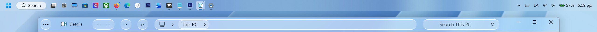

*⚠ **WARNING: This is an archived experimental sandbox repository for layout telemetry. For the official, production-ready and fully verified stable layout, please visit:**  ZEUSosX_044_Crystal_Ge_b26200 https://github.com/ZEUSosX/ZEUSosX_044_Crystal_Ge_b26200      

# ZEUSosX_044_Crystal_Ge_b26300_EXPERIMENTAL
 This theme veersion (for Windows 11 File Explorer Styler Theme/Windhawk) is an experimental beta vesrion. 

Compatible: 
* **Edition:** Windows 11 Pro / Home (Version 25H2)
* **OS Build:** 26200.9711
* **Experience Pack:** 1000.26100.372.0

Optimized strictly for the 150% layout baseline 

* **The complete production-ready YAML configuration file is available for direct view and copy here:**                                           
[ZEUSosX_044_Crystal_Ge_b26300_EXPERIMENTAL.yaml](https://github.com/ZEUSosX/ZEUSosX_044_Crystal_Ge_b26300_EXPERIMENTAL/blob/main/ZEUSosX_044_Crystal_Ge_b26300_EXPERIMENTAL.yaml)

====================================
28 October VERSION

Another EXPERIMENTAL version JUST for 26h2, just for testing.

* **The complete production-ready YAML configuration file is available for direct view and copy here:**                                           

[ZEUSosX_044_Crystal_Ge_b26300_EXPERIMENTAL_1_26H2.yaml](https://github.com/ZEUSosX/ZEUSosX_044_Crystal_Ge_b26300_EXPERIMENTAL/blob/main/ZEUSosX_044_Crystal_Ge_b26300_EXPERIMENTAL_1_26H2.yaml)

--------------

• Theme Name: ZEUSosX_044_Crystal

• Background Effect: acrylic

• Core Layout Height: 44px

⚠️ **Known Bugs & Limitations**

This ultra-compressed 1-row layout achieves minimalism via negative XAML bounds. Refer to the referenced repository for manual handling of window dragging, tab strips, and high-DPI font behaviors [1.6].

### 🖱️ Window Dragging (Mouse & Touch)
* **Issue:** Cannot click blindly on the top bar to drag the window.
* **Solution:** Target either the Search Box icon area, or the empty gap between Close/Caption buttons and the Search Box.

### 📑 No Tab Strip UI / Context Warning
* **Issue:** Tab strip region is completely collapsed.
* **Warning:** Never select "Open in new tab" from context menus (the new tab is created but remains invisible/inaccessible).
* **Solution:** Always use "Open in new window" instead.

### 🖥️ Desktop Launch Focus Glitch
* **Issue:** Opening a folder directly from the Windows Desktop may trigger a native focus bug, causing the Address Bar background to lock into solid white.
* **Solution:** Launch File Explorer via "This PC" (My PC) or use a standard pinned shortcut.

### 🔤 DPI Font Behavior
* **Expected:** Minor UI shifts.
* **Cause:** WinUI accessibility overrides.

🔒 **Terms of Use & Copyright**

✅ You CAN:

    Use it for free on your personal system.
    Apply it to your File Explorer.
    Share this repository link with others.

❌ You CANNOT:

    Modify, alter, or redistribute this code.
    Re-brand, rename, or take credit for creating it.
    Use it commercially, sell it, or rent it for profit under any circumstances.

License: Custom Standard Copyright - All Rights Reserved by ZEUSosX.

Copyright © 2026 ZEUSosX. 

All rights reserved. Custom Standard Copyright - All Rights Reserved by ZEUSosX [1.6].

Made in Greece, by ZEUSosX, (**Updated 27 October 2026**).
